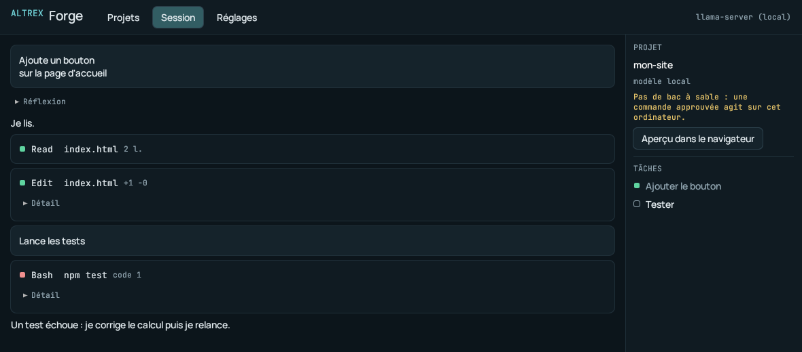

# Altrex pour PC : compiler, lancer, limites

État : **squelette qui tourne** (phase 1 de `docs/pc/PLAN.md`), version 0.1.0. La décision d'architecture (noyau en Rust, contrat partagé avec Android) est dans `PLAN.md`.



## Ce qui est là

- `pc/crates/altrex-core` : le moteur de Forge, sans interface. Outils Read, Write, Edit, MultiEdit, Glob, Grep, Bash, BashOutput, KillShell, TodoWrite, AskUserQuestion, ExitPlanMode ; autorisations (les quatre puces) et mode Plan ; journal JSONL au format du téléphone ; mémoire ALTREX.md ; modèles cloud (Claude par l'API Messages, les autres au format OpenAI) et `llama-server` ; aperçu local ; coffre des clés.
- `pc/crates/altrex-pc` : la fenêtre (egui), aux couleurs de Forge : Projets, Session, Réglages.
- `docs/forge/contrat/` : les vecteurs de test communs avec Android.

## Compiler et tester

Il faut Rust stable (1.80 ou plus récent ; écrit avec 1.97).

```bash
cd pc
cargo test                                   # 42 tests (noyau et session, sans fenêtre)
cargo clippy --all-targets -- -D warnings
cargo fmt --all --check
cargo run --release -p altrex-pc             # lance la fenêtre
cargo run --release -p altrex-pc -- /chemin/du/projet   # ouvre ce dossier et reprend sa dernière session
```

Linux, à l'exécution : un serveur graphique (X11 ou Wayland), OpenGL, et `libxkbcommon-x11` (Debian/Ubuntu : `apt install libxkbcommon-x11-0 libgl1 libegl1`).

### L'exécutable Windows

Deux chemins :

1. **CI (version à publier)** : `.github/workflows/build-pc.yml` construit `altrex-pc.exe` sur un runner Windows (cible MSVC) après avoir lancé `fmt`, `clippy` et les tests **sous Windows**. **Ce workflow est rédigé mais n'a jamais été exécuté** : son premier passage est à surveiller.
2. **Compilation croisée depuis Linux** (essai rapide) :

   ```bash
   sudo apt install gcc-mingw-w64-x86-64-posix zip
   rustup target add x86_64-pc-windows-gnu
   cd pc && ./empaqueter.sh        # pc/dist : .tar.gz Linux, .zip Windows, SHA256SUMS
   ```

   **Vérifié dans le conteneur Linux du 2026-11-11** : la compilation croisée produit un `altrex-pc.exe` valide (PE32+ GUI x86-64), **4,5 Mo** (2,2 Mo zippé), qui ne dépend que de DLL de Windows (`KERNEL32`, `USER32`, `GDI32`, `OPENGL32`, `ADVAPI32`, `crypt32`, `bcrypt`, `ws2_32`…, aucune DLL de mingw à fournir). `cargo clippy --all-targets --target x86_64-pc-windows-gnu` passe aussi (le code propre à Windows compile, tests compris). Le binaire Linux fait 6,4 Mo (2,8 Mo en `.tar.gz`). `cargo-xwin` (cible MSVC depuis Linux) n'a pas été essayé : mingw suffit et le SDK Windows ne tenait pas sur le disque.

## Utiliser

1. **Réglages → Modèle**.
   - *Modèle cloud* : choisis le fournisseur, colle ta clé d'API (« Enregistrer la clé »), puis le modèle (« Lister les modèles » interroge le fournisseur). La clé est chiffrée sur l'ordinateur (voir « Clés »).
   - *Modèle local* : indique le fichier **GGUF** (Argora ou autre) et, si besoin, le chemin de `llama-server` ; ou l'adresse d'un `llama-server` déjà lancé.
   - « Enregistrer les réglages ».
2. **Projets** : crée un projet (rangé dans `~/Altrex/projets/`) ou ouvre un dossier existant de l'ordinateur. Un dossier ouvert de l'extérieur n'est « pas approuvé » : son `ALTREX.md` n'est lu qu'après « Approuver ce projet ».
3. **Nouvelle session** : écris ta demande. Les puces du bas choisissent le mode : *Demander*, *Éditions auto*, *Plan*, *Tout autoriser*. Quand Forge veut modifier un fichier ou lancer une commande, une carte montre le diff ou la commande : Oui, Toujours, Non (avec un motif), Arrêter.
4. **Aperçu dans le navigateur** : sert le dossier du projet sur `http://127.0.0.1:<port>/` et l'ouvre dans le navigateur du système.

### `llama-server`

Altrex ne contient pas llama.cpp : il lance le `llama-server` officiel (licence MIT) et lui parle en HTTP.

- Téléchargement : <https://github.com/ggml-org/llama.cpp/releases>. Sous Windows, prends l'archive qui correspond à ta carte : **CUDA** (NVIDIA ; il faut aussi l'archive `cudart` indiquée sur la page), **Vulkan** (AMD, Intel, NVIDIA) ou **CPU**. Décompresse-la et donne le chemin de `llama-server.exe` dans les Réglages (ou mets le dossier dans le `PATH`, ou à côté d'`altrex-pc.exe`).
- Altrex le lance ainsi : `llama-server -m <modèle.gguf> --host 127.0.0.1 --port <port libre> -c <contexte> -ngl <couches GPU>`, attend `/health` (3 min au plus), et l'arrête à la fermeture de la session. « Couches sur le GPU » : 99 pour tout mettre sur la carte, 0 pour le processeur seul.
- Le modèle reçoit le **protocole texte** de Forge (`<tool_call>`), exactement celui de `docs/forge/OUTILS.md` et du jeu de données Argora ; le gabarit de conversation est celui du GGUF.
- Le téléchargement automatique (choix du backend, empreinte) n'est pas fait.

### Clés

- Windows : **DPAPI** (`CryptProtectData`), liée au compte Windows.
- Linux, macOS : AES-256-GCM, clé locale `coffre.cle` (droits 0600) dans le dossier des réglages. Cela protège d'une copie de `cles.json` seul, pas de quelqu'un qui a accès au compte.
- Réglages : `%APPDATA%\Altrex` (Windows), `~/.config/altrex` (Linux), `~/Library/Application Support/Altrex` (macOS). `reglages.json` ne contient aucun secret.

### Dossier de travail

`~/Altrex` par défaut, avec l'arborescence du téléphone : `projets/<nom>/`, `meta/<nom>.json`, `sessions/<projet>/<id>.jsonl`, `ALTREX.md`. Une session copiée depuis le téléphone s'ouvre telle quelle (les événements que le PC ne produit pas encore sont gardés sans perte).

## Ce qui n'est pas vérifié sur Windows

Aucune machine Windows n'était disponible : tout ce qui suit a été **compilé** pour Windows (compilation croisée et `clippy`) mais **jamais exécuté**.

- Le lancement de la fenêtre (OpenGL par `glow` ; sur un poste sans pilote OpenGL correct, ou en bureau à distance, il faudra passer au moteur `wgpu`).
- **PowerShell** : le script d'enrobage (`-EncodedCommand`, dossier courant, code de sortie), le choix `pwsh` / `powershell.exe`, l'encodage UTF-8 de la sortie, `taskkill /T /F` pour Arrêter. Un test dédié (`shell_powershell_sous_windows`) n'est exécuté que par la CI Windows.
- **DPAPI** (appels `CryptProtectData` / `CryptUnprotectData`).
- Les chemins `C:\…` : préfixe `\\?\`, casse, barres obliques inverses (un cas de test dans la CI Windows).
- Le dialecte PowerShell de la politique d'autorisation (lecture seule, commandes à risque) : testé comme texte ici, pas confronté à un vrai PowerShell.
- `llama-server.exe` et ses backends CUDA / Vulkan.
- Le workflow GitHub Actions lui-même.

Non vérifié non plus, faute de clé et de modèle dans le conteneur : un échange réel avec une API cloud ou avec un vrai `llama-server` (les clients sont testés contre de faux serveurs HTTP locaux qui rejouent les flux). Pour Claude, les blocs de réflexion signés sont renvoyés tels quels pendant une suite d'outils ; ce point précis est à confirmer avec une vraie clé. macOS n'est pas construit.

## Limites du squelette

- **Pas de bac à sable** : une commande approuvée agit sur l'ordinateur réel. Toute commande qui n'est pas de lecture est demandée, sauf en « Tout autoriser » ; les commandes à risque et les dossiers `.git` et `.altrex` sont toujours demandés.
- Pas encore portés du téléphone : compaction à deux niveaux (le PC retire seulement les plus anciens résultats d'outils quand le contexte déborde), instantanés et `/undo` `/diff`, WebFetch et WebSearch (les deux outils répondent « pas encore disponible »), commandes `/`, `@fichier`, mode léger, saisie pendant le travail, modes Build et Apprentissage, masquage des secrets dans les sorties de commandes, « lignes les plus proches » quand un Edit ne trouve pas son texte.
- Variables d'environnement : seul le dossier courant est gardé d'une commande à l'autre (pas les variables exportées).
- JSON des appels d'outils : strict (le téléphone, avec `org.json`, tolère les guillemets simples).
- Interface : texte brut (pas de rendu Markdown ni de coloration), pas de sélecteur de dossier graphique (on colle un chemin), un seul tour à la fois, « Lister les modèles » bloque la fenêtre pendant la requête.
- Pas d'installateur, pas de signature de code (SmartScreen avertira), pas de mise à jour automatique, pas de MCP, pas de terminal intégré, pas de notes vocales.

## Pour qui reprend le code

- Le comportement de référence est celui du téléphone. Avant de changer une règle (autorisations, lecture des commandes, format du journal, lecture des appels), **ajoute un cas dans `docs/forge/contrat/`** : il est exécuté par `pc/crates/altrex-core/tests/contrat.rs` et par `ContratPartageTest` côté Android.
- Écart trouvé pendant le portage, à corriger côté Android un jour : après une dernière ligne coupée dans un journal (arrêt en pleine écriture), `SessionJournal.load` ajoute ses lignes de réparation à la suite, sans retour à la ligne ; la première réparation se colle à la ligne abîmée et est perdue au rechargement suivant (elle est alors refaite). Le PC ferme d'abord la ligne coupée.
